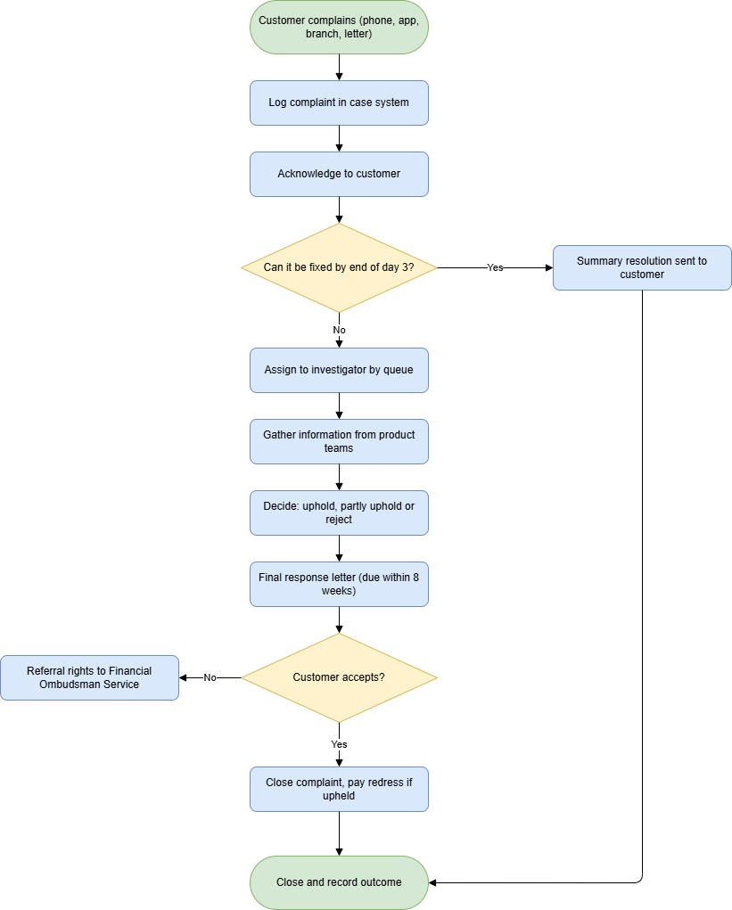
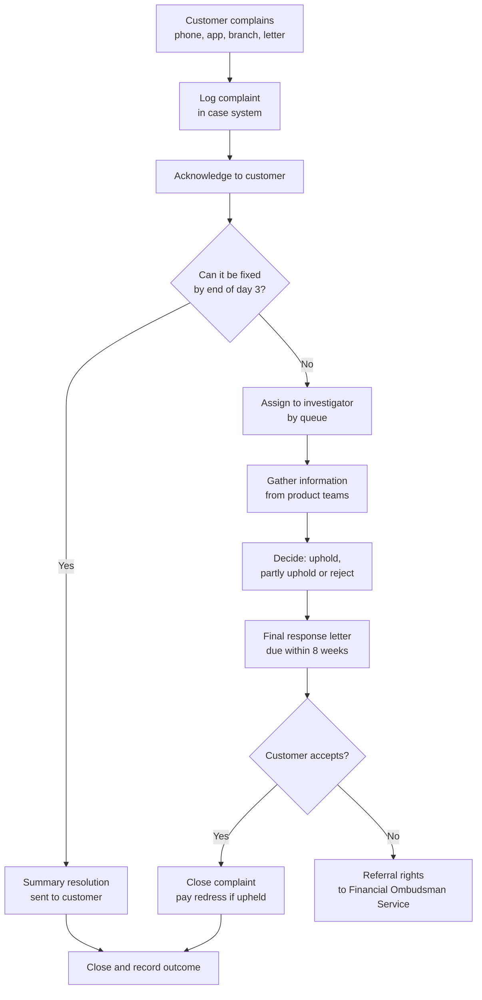

# As-Is Complaint Process (simulated retail bank)

> DRAFT – prepared with Claude, pending review by Kumar. The Bank and its process steps are simulated, built from the FCA's complaint rules and closing-time bands. They are not a real firm's process.

## How the FCA data maps to process stages
| Stage | FCA rule / data band |
|---|---|
| Receive and log | Complaint counted as "opened" |
| Acknowledge | Firm must acknowledge promptly (DISP 1.6) |
| Resolve on the spot | "Closed within 3 days" (summary resolution, DISP 1.5) |
| Investigate | "Closed 3 days to 8 weeks" |
| Final response | Due within 8 weeks (DISP 1.6) |
| Overdue | "Closed over 8 weeks" |
| Escalation | Customer may refer to the Financial Ombudsman Service |

## Flow

Editable source: `01_as_is_process.drawio` (open in draw.io). Text version:

## Where the data points to delay (verified, 2026 H1, national)
- Only 44.7% of complaints are closed within 3 days; 5.5% take over 8 weeks.
- Decumulation & pensions: 21.5% within 3 days, 12.7% over 8 weeks.
- Investments: 25.6% within 3 days.
- Banking and credit cards firms: fastest quarter closes 59.2% within 3 days, slowest quarter 18.2% (weighted by complaints closed).

## Hypotheses to validate (not findings)
| # | Possible cause | How to test |
|---|---|---|
| H1 | Triage at day 1 does not separate quick fixes from investigations | Time-stamp samples; interview handlers |
| H2 | Handlers lack authority to settle small cases on the spot | Check approval limits in the Bank's policy |
| H3 | Information requests to product teams stall investigations | Measure waiting time between steps |
| H4 | Complex products (pensions, investments) need specialist handlers who are scarce | Compare queue times by product |
