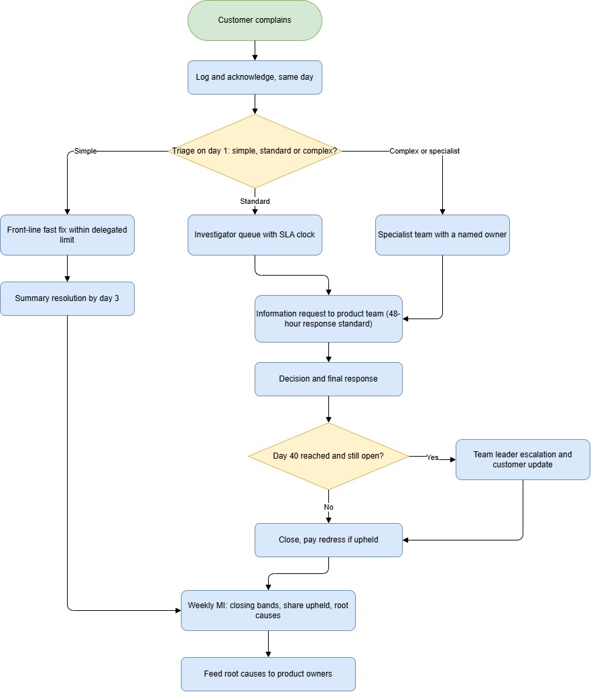
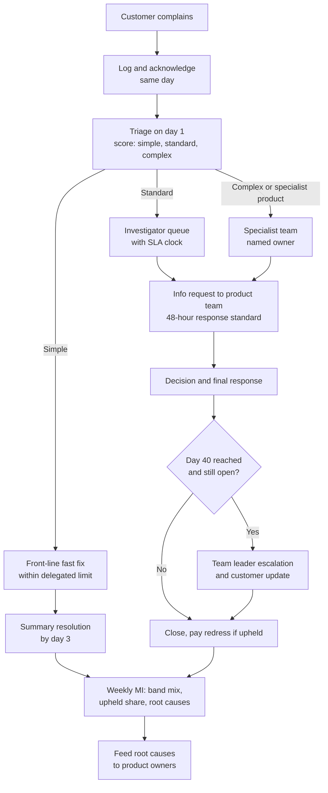

# To-Be Complaint Process (proposal)

> DRAFT – prepared with Claude, pending review by Kumar. Proposed changes are design ideas to test, not proven fixes. Impact figures need the Bank's own data and cost assumptions (US-09).

## Design principles
1. Decide at day 1 whether a complaint is a quick fix or an investigation.
2. Let front-line handlers settle small, clear cases within a set limit.
3. Give investigations a clock, with escalation before day 40 (eight weeks is 56 days).
4. Route specialist products to specialist handlers.
5. Track the FCA bands internally every week.

## Flow

Editable source: `02_to_be_process.drawio` (open in draw.io). Text version:

## Changes mapped to requirements and hypotheses
| Change | Addresses | Linked BR / US |
|---|---|---|
| Day-1 triage score | H1 | BR-10 / US-10 |
| Delegated settlement limit | H2 | BR-02, BR-09 |
| 48-hour product-team response standard | H3 | BR-02 |
| Specialist routing | H4 | BR-03 |
| Weekly band MI and root-cause loop | Monitoring | BR-01, BR-04 |

## Measures of success (targets TBC with the sponsor)
- Share closed within 3 days (benchmark: banking fastest quartile 59.2%; market 44.7%).
- Share over 8 weeks (market 5.5%).
- Share upheld tracked, not targeted (a target could push wrong outcomes).
