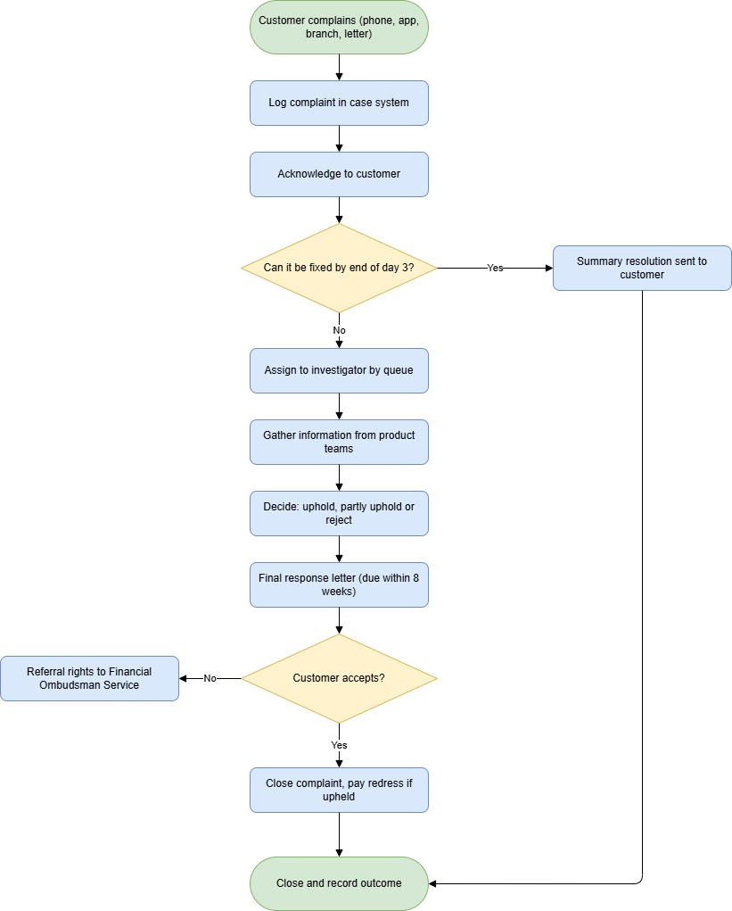
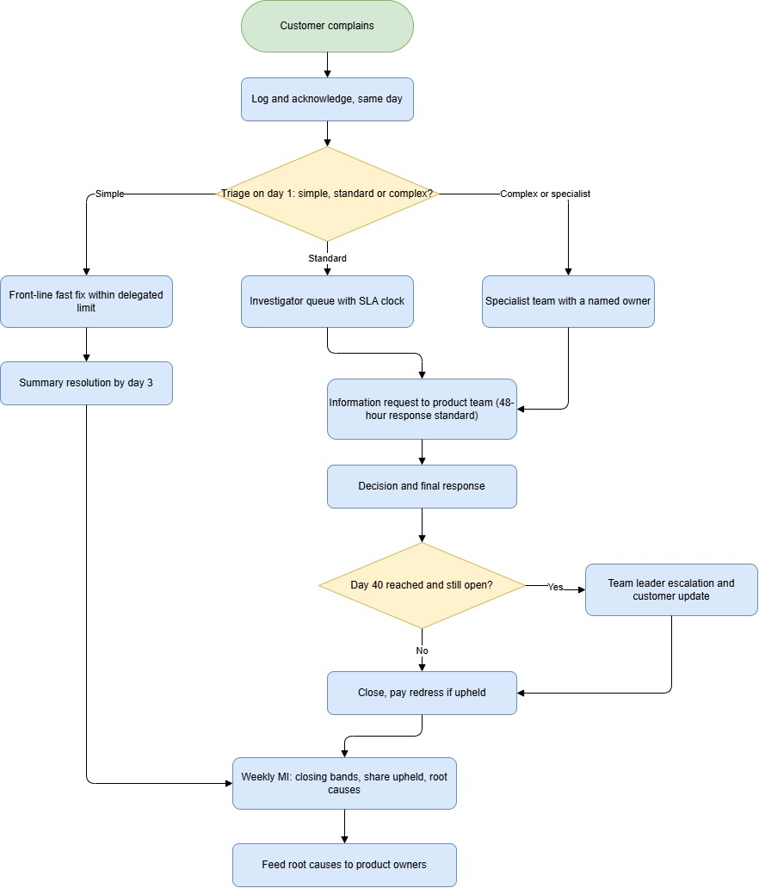

# UK Financial Complaints: Where Does Handling Break Down?

A business analysis of FCA complaints data (H1 2026 release), taken from problem statement to a redesigned process and an illustrative business case. Simulated sponsor: Head of Customer Operations at a fictional UK retail bank.

**Headline:** fewer than half of UK financial complaints are closed within 3 days (44.7% in 2026 H1), and that has barely moved since 2021. Speed varies far more by sector and by firm: banking firms in the fastest quarter close 59.2% within 3 days, the slowest quarter 18.2%.

## What is in this repo
| Folder | Contents |
|---|---|
| `01_business` | Problem statement, stakeholder map, BRD, user stories |
| `02_data` | Raw FCA files (never edited) and the cleaned SQLite database |
| `03_sql` | SQL for each user story (US-01 to US-08) |
| `04_dashboard` | Dashboard data exports |
| `05_findings` | Findings and recommendations memo |
| `06_process` | As-is and to-be process maps |
| `clean_data.py` | Loads and reshapes both FCA files into `complaints.db` |

## Outputs
- [Live dashboard](https://claude.ai/artifact/ADBfkRnV5GMB41bB7cvRzQ): trend, closing mix, product groups, anonymised firm benchmark, data limits.
- [Business-case calculator](https://claude.ai/artifact/1A7E4Vjrdnr6Ff5zzR3xoq): illustrative placeholder assumptions for a mid-size bank. Replace the yellow cells with real figures.
- Findings memo: `05_findings/findings_and_recommendations.md`.

## Process maps
As-is process (simulated bank):

Proposed to-be process (design ideas to test, not proven fixes):

## Method
1. Framed the business problem and requirements (BRD, user stories).
2. Cleaned and reshaped the aggregate (long) and firm-level (wide) FCA files with Python and SQLite.
3. Wrote SQL for each user story. Percentages are recalculated from counts and weighted by complaints closed, never averaged.
4. Mapped the as-is and a proposed to-be process, with causes marked as hypotheses to test.
5. Built an illustrative business case with clearly labelled assumptions.

## Data notes
Data: FCA complaints data, H1 2026, Open Government Licence v3.0. Firms report different periods, firm-level data covers 94.9% of complaints opened, and FCA and Financial Ombudsman data are not comparable. Firm names are anonymised. This is an independent portfolio analysis, not an FCA publication and not a statement about any firm's compliance.

## How I used AI
I used Claude to help draft documents, SQL, Python and the dashboard. I defined the question, chose the scope and framing, checked results against the FCA's published figures, and made the judgement calls on assumptions and recommendations. The sponsor and stakeholder interviews are simulated.

## About
Kumar Lakshya: MBA (University of Glasgow) with 3+ years as a Data Analyst Lead at Wipro, working in strategy, business analysis and project engineering. [LinkedIn](https://www.linkedin.com/in/kumarlakshya9600)
